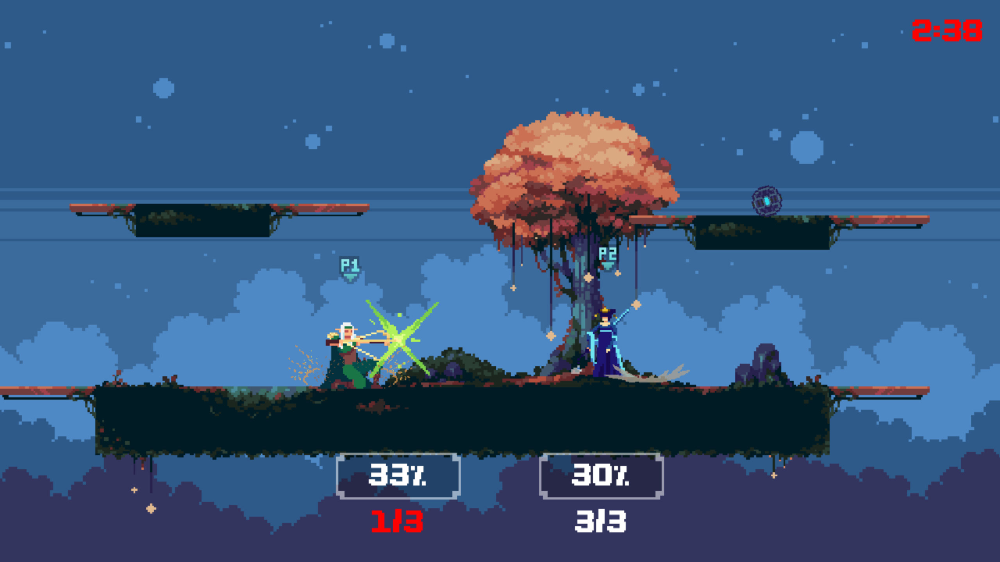

# Super Pixel Smash (Projet étudiant)

Jeu de combat en arène 2D (architecture ECS en C++20, SDL3 et Box2D) réalisé dans le cadre du projet de fin de 1re année à l'ESIEA (2025).



## Le jeu

Affrontez jusqu'à 4 joueurs (ou contre l'IA) dans une arène avec plateformes, objets bonus et personnages aux compétences distinctes.

* **Personnages jouables** : *Fire Knight*, *Water Priestess*, *Leaf Ranger*.
* **Modes de jeu** : temps limité ou nombre de vies, avec support des joueurs contrôlés par l'IA (`CPU`).
* **Objets** : bombes, potions de soin, flèches, boucliers.

### Commandes

Le jeu se joue au **clavier** et à la **manette** (jusqu'à 4 manettes).

* **Déplacement / Saut / Plateformes** : Flèches directionnelles ou Stick gauche / Croix directionnelle.
* **Attaques & compétences / Défense** : touches d'action clavier ou boutons manette (`A`, `X`, `B`, `LB`/`RB`).
* **Pause / Menu** : `Entrée` / `Start` et `Échap` pour quitter.

---

## Compiler et lancer

### Windows (Visual Studio / MSVC)

Le dépôt inclut toutes les dépendances (`SDL3`, `SDL3_image`, `SDL3_ttf`, `SDL3_mixer`, `Box2D`, `ImGui`, `EnTT`, `cJSON`, `magic_enum`) dans `third_party/`.

1. Ouvrir le dossier `Super-Pixel-Smash-SDL3` dans **Visual Studio** (détection automatique de `CMakeLists.txt`), ou exécuter `build_vs.bat` pour générer la solution dans `_build_vs/`.
2. Sélectionner la cible `application` et lancer avec **F5** ou **Ctrl+F5**.

### Linux (GCC / CMake)

Installer les paquets de développement sur Fedora :

```bash
sudo dnf install cmake gcc-c++ SDL3-devel SDL3_image-devel SDL3_ttf-devel SDL3_mixer-devel Box2D-devel
```

Puis compiler et exécuter depuis `_bin/Release/` (pour que le chemin relatif `../../assets/` soit valide) :

```bash
cmake -B _build_linux -DCMAKE_BUILD_TYPE=Release
cmake --build _build_linux -j4
cd _bin/Release && ./application
```

---

## Tests unitaires

Une suite de tests pour les utilitaires mathématiques et aléatoires est disponible dans `tests/test_utils.cpp` :

```bash
g++ -std=c++20 -Wall -Iengine/src \
    -Ithird_party/imgui-1.91.9b -Ithird_party/imgui-1.91.9b/backends \
    -Ithird_party/cJSON -Ithird_party/entt-3.15.0/src -Ithird_party/magic_enum/include \
    -Ithird_party/SDL3_mixer/include -Ithird_party/box2d-3.1/include \
    tests/test_utils.cpp -lm -o test_utils && ./test_utils
```

---

## Structure du projet

```text
Super-Pixel-Smash-SDL3/
├── application/   # Code du jeu (ECS joueurs, objets, scènes, UI)
├── engine/        # Moteur 2D SDL3 / Box2D / EnTT / ImGui
├── assets/        # Sprites, fonds, polices, sons, musiques et licences
├── docs/          # Emplacement pour la capture d'écran (screenshot_start.png)
├── tests/         # Tests unitaires C++
└── third_party/   # Dépendances C/C++ et bibliothèques Windows x64
```

## Licence

Le code est distribué sous licence MIT (voir [LICENSE.md](LICENSE.md)).
Les licences des ressources graphiques et sonores sont détaillées dans [assets/LICENSE.md](assets/LICENSE.md).

